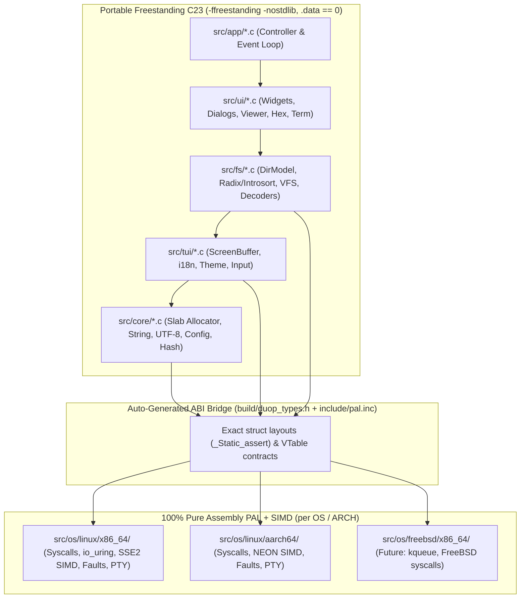

# План реалізації гібридної архітектури («Asm PAL + SIMD» + «Freestanding `no-libc` C23»)

## Мета

Забезпечити повноцінну мультиархітектурну та мульти-ОС переносимість **Duop** (перший етап — **Linux x86-64** та **Linux AArch64**, далі — **FreeBSD**) **без порушення** ключових інваріантів проєкту:
- **Zero external dependencies**: статичний ELF64 без `libc` та `ncurses` (`readelf -d` без `.dynamic`);
- **`ELF .data == 0`**: усі мутабельні глобальні змінні лише в `.bss` або купі, константи в `.rodata`;
- **Компактний бінарник і максимальна швидкодія**: ~190–250 KiB stripped, старт `< 1 ms`, `io_uring`, `FICLONE`/`copy_file_range`, SSE2/NEON SIMD;
- **Нульовий простій при міграції**: завдяки тому, що код у `src/` дотримується System V ABI (`rdi` = `this`, `Object.vptr` за зміщенням `0`), мігровані `.c` модулі лінкуються через `ld` напряму з існуючими `.s` модулями на `x86_64` на кожному кроці.

---

## Відкриті архітектурні рішення (узгодити перед стартом)

1. **Мова портативних шарів (`core/`, `tui/`, `fs/`, `ui/`, `app/`):**
   - **Рекомендовано:** **Freestanding C23** (`clang` / `gcc` з `-ffreestanding -nostdlib`).
   - Альтернативи: **QBE** або **Zig**.
2. **Міграція `TRY/CATCH` (`try_rt.s`):**
   - Заміна розкрутки стека на явні коди помилок + макроси очищення (`DUOP_DEFER`), зі збереженням `os_sigbus_guard_install()` у `pal_fault.s` для захисту `mmap` від `SIGBUS`.
3. **Пріоритет першої нової платформи після `linux/x86_64`:**
   - **`linux/aarch64`** (де вже написано 1 249 рядків PAL у `src/os/linux/aarch64/`) чи **`freebsd/x86_64`**?

---

## Поетапний план реалізації

### Етап 0. Інфраструктура збірки, генератор ABI-хедерів та гейти перевірки

1. **`[NEW] include/duop_abi.h`**:
   - Базові freestanding типи (`stdint.h` / `stddef.h` без `libc`), макроси секцій, прототипи PAL-функцій (`os_statat`, `os_poll_in2`, `os_pipe_cloexec`, `os_clone_file`, `os_copy_file_range`, `os_mem_*`, `os_du_usage`, `os_mmap_file_ro`, `os_watch_*`) і `_Static_assert(sizeof(FileStat) == 56)`.
2. **`[NEW] tools/gen_c_headers.py`**:
   - Автоматична генерація `build/duop_types.h` із [include/types.inc](file:///home/chessplayer/DEV/NC/include/types.inc), [include/classes.inc](file:///home/chessplayer/DEV/NC/include/classes.inc) та [include/config.inc](file:///home/chessplayer/DEV/NC/include/config.inc) (структури `Rect`, `Event`, `FileEntry`, `Object`/`Widget`/`Dialog` та їх `vtable` + `_Static_assert` на розміри й зміщення).
3. **`[MODIFY] Makefile`**:
   - Додати `CC` (`clang`/`gcc`), прапорці `-ffreestanding -nostdlib -fno-builtin -fno-asynchronous-unwind-tables -fno-stack-protector -fno-ident -fdata-sections -ffunction-sections -Os -Wall -Wextra -Werror`, `--gc-sections` у `release`, підтримку змішаної лінковки `SRCS` (`.s`) + `C_SRCS` (`.c`).
4. **`[MODIFY] check_modularity.py` та `check_lean.py`**:
   - Поширити правила ізоляції шарів (заборона `#include <stdio.h>` / `<stdlib.h>` та raw `syscall`), перевірку `.data == 0` і бюджету модулів (`<= 400` рядків / `<= 80` рядків на функцію) на `src/**/*.c`.

### Етап 1. Уніфікація PAL і точки входу `_start`

1. **`[NEW] src/os/linux/x86_64/pal_start.s` та `src/os/linux/aarch64/pal_start.s`**:
   - Мінімальний `_start` (~25 рядків), що дістає `argc`, `argv`, `envp` зі стека ядра, вирівнює `sp` по 16 байтах, викликає `duop_main(argc, argv, envp)` і завершується через `os_exit`.
2. **`[MODIFY] src/os/linux/<arch>/pal_os.s`**:
   - Винести тонкі C-сумісні обгортки для базових сисколів (`os_openat`, `os_read`, `os_write`, `os_close`, `os_getdents64`, `os_mmap_anon`, `os_mremap`, `os_fork`, `os_execve`, `os_waitpid`, `os_kill`, `os_clock_ms`, `os_exit`), щоб шар C не містив жодного `syscall`.
3. **`[MODIFY] tools/abi_verify.c`**:
   - Перевірка ABI-сумісності структур під `x86_64` та `aarch64`.

### Етап 2. Інкрементальна міграція `src/core/` та `src/tui/`

1. **`src/core/`**: перенести `memory.c` (slab-алокатор), `string*.c`, `utf8.c`, `oop_rt.c`, `config*.c`, `hash*.c` із викликами SIMD-примітивів у `pal_simd.s`.
2. **`src/tui/`**: перенести `theme.c`, `i18n*.c`, `screen*.c` (зберегти гарячий `os_mem_mismatch16` у `pal_simd.s`), `input*.c`, `kbd_*.c`.

### Етап 3. Інкрементальна міграція `src/fs/`

1. Перенести `dir_model*.c`, `dir_sort*.c` (Introsort + LSD Radix Sort), `dir_cache*.c`, `dir_watch.c`, `dir_search*.c`, `dir_fuzzy*.c`, `dir_diff.c`.
2. Перенести `file_ops*.c`, `task*.c`, `trash_undo.c`, `inflate.c`, `archive_*.c`, `disk_usage.c` (із викликом `pal_du.s`), декодери зображень (`img_*.c`) та `pkg_*.c`.

### Етап 4. Інкрементальна міграція `src/ui/`, `src/app/` і перша нативна збірка AArch64

1. Перенести віджети та діалоги `src/ui/*.c` (`header_bar`, `function_bar`, `status_bar`, `file_pane`, `preview_pane`, `viewer_*`, `term_pane`, `syntax`, `elf_inspect`, `hex_edit`).
2. Перенести `src/app/*.c` (`duop_main`, цикл подій, диспетчеризацію команд).
3. Увімкнути повну лінковку `make OS=linux ARCH=aarch64 release` та протестувати через `qemu-aarch64`.

### Етап 5. Розширення на інші ОС (`src/os/freebsd/<arch>/`)

- Реалізувати лише PAL (`pal_start.s`, `pal_os.s` із `kqueue` замість `inotify`, `pal_pty.s`, `pal_fault.s`) без жодних змін у шарах `.c`.

---

## План верифікації

Після **кожного** перенесеного модуля на `x86_64` запускати:
1. `python3 .agents/skills/duop-modular-asm/scripts/check_modularity.py` та `check_lean.py`
2. `make audit-all`
3. `size duop` (перевірка `.data == 0`) та `readelf -d duop` (відсутність `.dynamic`)
4. `./.agents/skills/duop-pty-verify/scripts/verify_build.sh` (усі 50 PTY/FS/security/memcheck тестів)
5. `./scripts/bench.sh ./duop` (контроль часу старту `< 1 ms` та відкриття 100k файлів)
6. По завершенню Етапу 4: `make OS=linux ARCH=aarch64 release` + `qemu-aarch64 ./duop --version` і PTY-смоук тести під `qemu-aarch64`.
