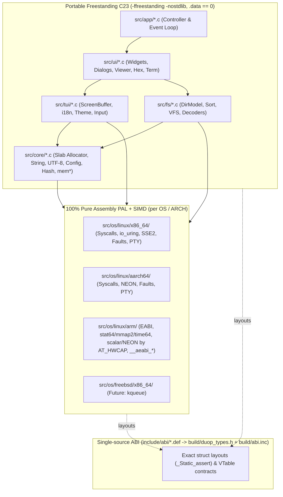

# План реалізації гібридної архітектури («Asm PAL + SIMD» + «Freestanding `no-libc` C23»)

> Редакція 2 (рев'ю від 2026-11-17). Перелік виправлень до редакції 1 — у розділі «Журнал рев'ю» наприкінці.

## Мета

Забезпечити повноцінну мультиархітектурну та мульти-ОС переносимість **Duop** (**Linux x86-64**, **Linux AArch64 / ARM64**, **Linux ARMv7 / ARM32**, а далі — **FreeBSD**) **без порушення** ключових інваріантів проєкту:
- **Zero external dependencies**: статичний ELF (**ELF64** для `x86_64`/`aarch64`, **ELF32** для `arm`) без `libc`, `ncurses`, `libgcc` (`readelf -d` без `.dynamic`, `readelf -l` без `INTERP`);
- **`ELF .data == 0`**: усі мутабельні глобальні змінні лише в `.bss` або купі, константи в `.rodata`;
- **Компактний бінарник і швидкодія**: поточна база `x86_64` (v2.6.6): `text` ≈ 195 KiB, файл ≈ 202 KiB, `bss` ≈ 784 KiB, старт `< 1 ms`; `io_uring`, `FICLONE`/`copy_file_range`, SSE2/NEON SIMD. Бюджет після міграції — **вимірюваний** (див. «Етап 0.0» і критерії Go/No-Go), а не оцінений «на око»;
- **Безперервна працездатність при міграції**: `.c` модулі лінкуються `ld` з існуючими `.s` модулями на `x86_64` на кожному кроці — **за умови**, що кожен мігрований символ має чистий System V контракт (див. «Контракти виклику asm ↔ C»).

> **Політична зміна.** План міняє ідентичність проєкту («pure x86-64 assembly», `AGENTS.md`, `README*.md`, skills `duop-modular-asm` / `duop-lean-modules` / `duop-tdd-first`). До старту Етапу 1 потрібне явне рішення власника і оновлення `AGENTS.md` (нові шари `.c`, правила стилю, бюджети) — інакше хуки/pre-commit блокуватимуть `.c`.

Діаграма відображає правила `AGENTS.md §1`: `fs` **не** залежить від `tui`; `ui` залежить і від `tui`, і від `fs`; `tui` і `fs` — незалежні сусіди, тому Етапи 2 і 3 можна вести паралельно.

---

## Відкриті архітектурні рішення (узгодити перед стартом)

1. **Мова портативних шарів:** **Freestanding C23** (`clang` ≥ 18 / `gcc` ≥ 13; C23 `constexpr`, `nullptr`, `[[...]]`, `#embed` — лише якщо мінімальна версія зафіксована в `Makefile`-перевірці `make check-toolchain`). Альтернативи: **QBE**, **Zig**. *Альтернатива «не мігрувати»:* лишити asm для `x86_64` і писати окремі asm-бекенди для кожної ISA — відхилено (53 тис. рядків × N архітектур), але рішення має бути зафіксоване письмово.
2. **Міграція `TRY/CATCH` (`try_rt.s`, `try_using.inc`):** розділити два різні механізми:
   - *нормальні помилки* → явні коди повернення + `DUOP_DEFER` (`__attribute__((cleanup))`);
   - *апаратні фолти* (SIGSEGV/SIGBUS/SIGFPE при `mmap`/парсерах) → **лишається** non-local jump (`duop_try_save` / `duop_try_restore` у `pal_fault.s` по архітектурі; C-обгортка `DUOP_TRY` з `__attribute__((returns_twice))`, локальні змінні між save і catch — `volatile`). `cleanup`-атрибут **не** спрацьовує при stack-switch із сигнал-обробника, тому він не замінює `TRY/CATCH` для фолтів. Розташування `ucontext_t.gregs` — різне для кожної ISA (зараз зашите в `try_using.inc` для x86-64).
3. **Пріоритет першої нової платформи:** **`linux/aarch64`** (PAL уже є, ≈ 1 270 рядків у `src/os/linux/aarch64/`, але **неповний і не виконувався** — див. Етап 1b). `freebsd/x86_64` — після нього.
4. **Мінімальне ядро (kernel floor) на архітектуру.** Зафіксувати й задокументувати: напр. `x86_64`/`aarch64` ≥ 5.4 (statx, copy_file_range, renameat2, `io_uring` опційно); `arm` — або ≥ 4.11 (statx), або з `fstatat64`/`copy_file_range`-fallback для RouterOS v6 (ядро 3.3/4.x). Кожен syscall новіший за floor має `ENOSYS`-fallback (copy_file_range → read/write, renameat2 → `linkat`+`unlinkat`, statx → `fstatat64`, `io_uring` → `ppoll`).
5. **База ARM32:** ARMv7-A, **soft-float ABI коду** (`-mfloat-abi=soft`: плаваюча кома в Duop не потрібна; бінарник працює і на `armel`, і на `armhf`, без залежності від VFP). NEON — лише в `pal_simd.s` з одноразовим вибором реалізації за `AT_HWCAP` (auxv) під час старту (через вказівник у `.bss`, **не** через runtime-OS-перевірки). ARMv6 (**Raspberry Pi 1/Zero**, ARM1176) — окрема ціль `-march=armv6k`; ARMv7 бінарник на них не запуститься.
6. **Напрям генерації ABI** (див. Етап 0.2): одне джерело правди, а не «`.inc` → `.h`» назавжди.

---

## Контракти виклику asm ↔ C (обов'язково до першої міграції)

Заява «`.c` лінкується з `.s` напряму» хибна без цих кроків:

1. **Нестандартні контракти повернення.** `audit_live_regs_baseline.json` фіксує «accepted» винятки: `utf8_decode` (довжина в `rdx`), `parse_uint` (просунутий вказівник у `rdi`), `fo_resolve_eexist_open` (`edx`), `term_cell_px` / `isc_span` (`eax`+`edx`), `cec_emit_sq/dq` (`rcx`), inline-хелпер `qoi_op` (`r9d/r10d/r12`). C-функція **не може** виконати такий контракт. Для кожного мігрованого символу: або повернення `struct { uint64_t a, b; }` (SysV: `rax:rdx`; AAPCS64: `x0:x1`; AAPCS32: `r0:r1` для 2×`uint32_t`), або тонкий asm-thunk, або одночасна міграція викликачів. Baseline перераховується на кожному кроці.
2. **Затирання caller-saved.** C-код вільно змінює `rcx/rdx/rsi/rdi/r8–r11`, `xmm*`; asm-викликачі, що «непомітно» покладалися на збереження цих регістрів (клас помилок із аудиту 2026-11-16), після міграції зламаються мовчки. **Гейт:** `audit_live_regs.py` без нових записів у baseline + `audit_abi_regs.py`/`audit_syscall_clobber.py` перед і після кожного модуля. Також: C припускає `DF = 0` і вирівнювання стека на межі `call`.
3. **Компілятор генерує виклики сам.** Навіть із `-ffreestanding` clang/gcc емітують `memcpy`/`memset`/`memmove`/`memcmp`/`bcmp` (копія структур, ініціалізація масивів, ідіоми циклів). Обов'язково надати їх у `src/core/` (тонкі обгортки над `pal_simd.s`). Для ARM32 додатково: `__aeabi_memcpy{,4,8}`, `__aeabi_memmove*`, `__aeabi_memset*`, `__aeabi_memclr*`, **32-бітні** `__aeabi_idiv`/`__aeabi_uidiv`/`__aeabi_idivmod`/`__aeabi_uidivmod` (якщо ціль без апаратного ділення — а базовий ARMv7-A його не гарантує) і 64-бітні `__aeabi_uldivmod`/`__aeabi_ldivmod`. Альтернатива власним `pal_aeabi.s` — слінкувати `compiler-rt builtins` (без libc) і виміряти розмір. Для AArch64: `-mno-outline-atomics` (інакше `__aarch64_ldadd*` з libgcc). Заборонити `__int128`, VLA, `alloca`, `<math.h>`.
4. **Різниці ABI між архітектурами**, які asm мав «безкоштовно»: `char` — знаковий на x86, **беззнаковий на ARM** → єдиний `-funsigned-char`; невирівняні читання у парсерах (inflate/PNG/JPEG/ELF/tar) — лише через `load_le16/32/64` на `__builtin_memcpy` (UB в C + `LDM/LDRD` на ARMv7 дають alignment fault); `-fno-strict-aliasing`; без variadic у внутрішніх API (`string_format` має власну конвенцію); у C23 усі поля `.struct` — типи фіксованої ширини (`uint32_t`, не `int`/`bool`).
5. **ABI-прапорці збірки** (без них Ubuntu/Debian-тулчейни тихо додають зайве й ламають `.data == 0` / розмір): `-fno-pic -fno-pie -static -no-pie -fcf-protection=none -fno-stack-protector -fno-stack-clash-protection -fno-asynchronous-unwind-tables -fno-unwind-tables -fno-ident -funsigned-char -fno-strict-aliasing -fno-common -ffreestanding -nostdlib -nostartfiles -nodefaultlibs`; лінкер: `-z noexecstack -z norelro --build-id=none --gc-sections` (і в debug). `-fno-builtin` **не додавати окремо**: `-ffreestanding` уже його імплікує, а для малих фіксованих копій дозволити `__builtin_memcpy`.
6. **Стек.** Asm-аудити (`audit_stack_depth.py`, `audit_cfg_stack.py`) не бачать C. Замінити: `-Wframe-larger-than=<N>` + `-fstack-usage` (`.su`) + аналізатор глибини викликів по `objdump`/`-fcallgraph-info`; `duop-bounded-resources` лишається в силі (жодної необмеженої рекурсії по директоріях). Ліміти фреймів — окремо для worker-потоку/форка й `sigaltstack`.

---

## Поетапний план реалізації

### Етап 0. Базова лінія, інфраструктура збірки, ABI-генератор і гейти

**0.0. Вимірювання та спайк (Go/No-Go) — до будь-якої міграції.**
   - Зафіксувати базу: `size`, розмір файлу, `scripts/bench.sh` (старт, 100k файлів), peak RSS, кількість syscalls на старті (`strace -c`).
   - Портувати **3 репрезентативні модулі** кінцевим набором прапорців: `utf8` (листок, гарячий), `dir_sort_radix` (SIMD/алокація), `inflate` (парсер із бітовими операціями). Порівняти розмір `.text` і швидкість із asm.
   - **Критерії Go:** `.text` мігрованих модулів ≤ **+30 %** до asm, жодної регресії старту `> 0.2 ms`, жодних регресій у гарячих шляхах `> 10 %`; інакше — залишити гарячі листки в asm per-arch (SIMD-ядра вже там) і переглянути обсяг міграції. Орієнтир «~190–250 KiB stripped» із редакції 1 — **не обіцянка**, а гіпотеза для перевірки цим спайком.

**0.1. `[NEW] include/duop_abi.h`**: freestanding типи (`<stdint.h>`, `<stddef.h>`, `<stdbool.h>`, `<stdarg.h>` — заголовки компілятора, не libc), макроси секцій/атрибутів (`DUOP_NORETURN`, `DUOP_RETURNS_TWICE`, `DUOP_SECTION_RODATA`), прототипи PAL: `os_statat`, `os_poll_in`/`os_poll_in2`, `os_pipe_cloexec`, `os_clone_file`, `os_copy_file_range`, `os_mem_*` (`os_mem_remap`, `os_mem_mismatch16`), `os_munmap`, `os_du_usage`, `os_mmap_file_ro`, `os_watch_add/rm/read/next`, `os_sigbus_guard_install`, `os_dir_read/next`, `os_clock_ms`. `_Static_assert(sizeof(FileStat) == 56)` — **на всіх цілях** (поля `size/mtime/ino/dev` — завжди 64-бітні).

**0.2. `[NEW] tools/gen_abi.py` — одне джерело правди для структур.**
   - Редакція 1 генерувала `.h` з `types.inc`/`classes.inc`/`config.inc`, але в `.struct` усе — `.quad`: генератор не відрізнить вказівник (4 Б на `arm`) від `int64_t`. Тому: ввести розмітку (`PTR`-макрос/коментар-тег у `.struct`, або окремі `include/abi/*.def`) і генерувати **обидва** артефакти — `build/duop_types.h` і `build/abi.inc`.
   - **Напрям:** до завершення Етапу 4 джерело — `.inc` (asm ще основний споживач); після міграції всіх споживачів `.struct` у `.s` лишається лише PAL (`FileStat`, `termios`, `dirent`, `sigaction`, `pollfd`) — тоді джерелом стає `.def`/`.h`, а `.inc` генерується для PAL.
   - **Підтримка `ARCH=arm`:** вказівники/слоти `vtable` — `uintptr_t` (4 Б на `arm`, 8 Б на `x86_64`/`aarch64`); розміри, `ino`, `dev`, час (`FileStat.size/mtime`, `FileEntry.size`) — **фіксовані 64-бітні** (`int64_t`/`uint64_t`; файли > 4 GiB). Усі `_Static_assert(offsetof/sizeof)` генеруються окремо для кожної цілі. Це означає, що `.struct` для `arm` не може використовувати «`8`-байтові слоти для вказівників» — потрібен параметр `PTR_SIZE` у `include/os/linux/arm/pal_target.inc`.

**0.3. `[MODIFY] Makefile`** (перелік вимог, а не лише прапорців):
   - `CC` (`clang`/`gcc`), `CROSS_PREFIX`/`--target=` per `ARCH`, `LD` per `ARCH` (`ld -m elf_x86_64 | aarch64linux | armelf_linux_eabi`; або єдиний `ld.lld`), `-march`/`-mthumb` (Thumb-2 для `arm` зменшує розмір ≈ 25–30 %; PAL-asm — `.syntax unified` + `.thumb_func` або ARM-режим з interworking, одне рішення на ціль).
   - Прапорці з розділу «ABI-прапорці збірки», `-Os -Wall -Wextra -Werror -Wframe-larger-than=…`, `-MMD -MP` (залежності `.h`), змішана лінковка `SRCS` (`.s`) + `C_SRCS` (`.c`), `-DMEMCHECK=1` як еквівалент `--defsym MEMCHECK=1`.
   - `make check-toolchain` (версії clang/gcc, наявність `aarch64-linux-gnu-*`, `qemu-*`), `make OS=… ARCH=…` не повинен мовчки підхоплювати `x86_64`-`SRCS` для іншої ARCH (зараз `SRCS` — x86-specific, див. Етап 4).

**0.4. `[MODIFY] check_modularity.py`, `check_lean.py`, `gen_symbols_catalog.py`, `audit_*`:**
   - Правила шарів для `src/**/*.c`: заборона `#include <stdio.h>/<stdlib.h>/<string.h>/<unistd.h>/<errno.h>`, заборона inline-`asm volatile("syscall")` та `__builtin_*` викликів libc-функцій; перевірка `.data == 0` на `.o` (`size -A`); бюджети `.c` ≤ 500 рядків, функція ≤ 80 рядків, ≤ 16 non-`static` символів (еквівалент `.global`).
   - `docs/SYMBOLS.md` генератор і `audit_oop_vtables.py`, `audit_fd_eintr.py`, `audit_unchecked_io.py` (розбирають `.s`) — або розширити на `.c`, або замінити еквівалентами (`-Wunused-result` + `[[nodiscard]]`, clang-tidy/`-fanalyzer`). Це **частина Етапу 0**, не «потім».
   - Оновити `AGENTS.md`, skills (`duop-modular-asm`, `duop-lean-modules`, `duop-tdd-first`), `README*.md`, хуки pre-commit; тести, що парсять `.s` (`test_pal_architecture.py`, `test_lean_gate.py`, `test_audit_live_regs.py`), — узгодити.

**0.5. `[NEW]` CI-матриця.** `x86_64` (нативно), `aarch64` (`qemu-aarch64` + нативний runner `ubuntu-24.04-arm`), `arm` (`qemu-arm`). `qemu-user` **не відтворює** частину семантики (SIGBUS при усіканні `mmap`, `io_uring`, `/proc/self/exe`, подекуди `execve`-шлях), тому fault-injection/SIGBUS/PTY-тести — на нативному arm64 або `qemu-system`; решта — під `qemu-user` з `binfmt_misc` (`-execve`/`QEMU_LD_PREFIX` не потрібні для static).

### Етап 1. Уніфікація PAL і точки входу `_start`

1. **`[NEW] src/os/linux/<arch>/pal_start.s`** (по одному на ціль, ~25 рядків): `_start` дістає `argc/argv/envp/auxv` зі стека ядра, вирівнює `sp` (x86-64/AArch64: 16 Б, ARM32: 8 Б), викликає `duop_main(argc, argv, envp)`, завершує через `os_exit`. Зараз `_start` — у **`src/main.s`** (x86-специфічний, ~150+ рядків, разом з CLI-розбором): розділити — `pal_start.s` лише стартує, `main.s` → `src/app/main.c` (`duop_main`) на Етапі 4. Передати `auxv` (потрібен для `AT_EXECFN`, `AT_HWCAP`, `AT_SYSINFO_EHDR` ігнорується).
2. **`[MODIFY] src/os/linux/<arch>/pal_os.s`**: C-сумісні тонкі обгортки над зараз **inline-макросами** `OS_*` (макроси C недоступні): `os_openat`, `os_read`, `os_write`, `os_close`, `os_getdents64`, `os_mmap_anon`, `os_mremap`, `os_fork`, `os_execve`, `os_waitpid`, `os_kill`, `os_clock_ms`, `os_exit` — таких символів зараз **немає**. Повернення: `-errno` у `rax`/`x0`/`r0` (як зараз), у C-шарі — `static inline bool os_is_err(long)` (`> -4096UL`). Обгортки не додають runtime-перевірок ОС.
3. **`[MODIFY] tools/abi_verify.c`**: зараз перевіряє **лише** `include/os/linux/x86_64/pal_target.inc` (`#include` системних заголовків хоста). Розширити: компілювати з `--target=<triple>` і заголовками ядра цільової архітектури (`/usr/aarch64-linux-gnu/include`, arm sysroot) і порівнювати `pal_target.inc` кожної ціли: `O_*`, `MAP_*`, `SA_*`, `SIG*`, `TC*`/`TIOC*`, `struct kernel_sigaction`, `termios`, `dirent64`, `statx`, `pollfd`, `ucontext` (gregs для `TRY`/`pal_fault`). Тест `test_pal_architecture.py::test_aarch64_pal_backend` лише **асемблює** файли — цього недостатньо.

### Етап 1b. «Ходячий скелет» на AArch64 (зсунуто з Етапу 4)

Редакція 1 вперше запускала aarch64-код лише наприкінці Етапу 4 — після міграції всього. Ризик: помилки PAL знаходяться, коли їх найдорожче виправляти. Тому одразу після Етапу 1:

1. **Закрити прогалини aarch64 PAL.** Порівняння глобальних символів `x86_64` (61) ↔ `aarch64` (53): в aarch64 **відсутні** `os_copy_file_range`, `os_mmap_file_ro`, `os_munmap`, `os_sigbus_guard_install`, `os_watch_add/next/read/rm` (inotify). Також відсутній аналог `pal_abi_ext.inc` (SIGxxx/`prctl`/`prlimit`).
2. **Виправити реальну помилку ABI:** `include/os/linux/aarch64/pal_target.inc`: `O_NOFOLLOW = 0x10000`, а в ядрі AArch64/ARM `O_NOFOLLOW = 0100000 (0x8000)`; `0x10000` (= `0200000`) — це **`O_DIRECT`**. Наслідок: на aarch64 захист від symlink-гонок (`duop-path-safety`) мовчки вимкнений, а `open` вмикає `O_DIRECT` (вимагає вирівнювання буферів → `EINVAL`). `O_DIRECTORY = 0x4000` — правильно. Інші `O_*` (`O_NONBLOCK 0x800`, `O_CLOEXEC 0x80000`, `O_CREAT/EXCL/TRUNC`) збігаються з x86. Виправлення — **через TDD** (`duop-tdd-first`, `duop-defect-regression`): спочатку падаючий тест `abi_verify` на aarch64-заголовках.
3. **Мінімальний C-скелет:** `duop_main` на C, що відкриває `.`, читає `getdents64`, друкує імена й виходить; `pal_selftest.c` (≈ 40 перевірок `os_*`: statat, pipe, poll, mmap/mremap, fork/wait, termios, sigaction/restorer, inotify, pty). Запуск під `qemu-aarch64` і на нативному arm64 у CI — **до** початку Етапу 2.
4. Перевірити специфіку AArch64: немає `open/stat/dup2/pipe/rename/…` (лише `*at`), `struct stat` — generic 128 Б (`newfstatat`), відсутній `SA_RESTORER` (x86-only; на aarch64 restorer — у vDSO/ядро), `sp` завжди 16-вирівняний (апаратно).

### Етап 2. Інкрементальна міграція `src/core/` та `src/tui/`

Порядок усередині етапу — від листків без стану до станових (`utf8`, `string*`, `hash*` → `memory` → `config*`, `oop_rt` → `theme`, `i18n*`, `screen*`, `input*`, `kbd_*`). `core` і `tui` — паралельні гілки.

1. **`src/core/`**: `utf8.c`, `string*.c`, `hash*.c`, `memory.c` (slab-алокатор: збереження семантики «zero-filled, 16-Б вирівнювання, header 16 Б»; **на `arm` — 4-Б вказівники й 32-бітний адресний простір**: `SLAB_ARENA`/`MAX_SLAB_ARENAS`/великі `mmap` для `DirModel` переглянути під ≈ 3 GiB VA; `size_t` ≠ `uint64_t`), `oop_rt.c`, `config*.c`, **`mem*`-примітиви компілятора** (див. «Контракти»). Виклики SIMD — через `pal_simd.s`. `memcheck.s` (`MEMCHECK`) — окрема міграція з тестом `test_memcheck.py`.
2. **`src/tui/`**: `theme.c`, `i18n*.c`, `screen*.c` (зберегти гарячий `os_mem_mismatch16`), `input*.c`, `kbd_*.c`. Інваріанти i18n з `AGENTS.md §2` лишаються: `LangStrings`-слоти, `lang/*.lang`, `layouts/*.layout`, `utf8_display_width`.
3. Після кожного модуля — повний цикл «План верифікації» + запуск `pal_selftest` на aarch64 (smoke).

### Етап 3. Інкрементальна міграція `src/fs/`

1. `dir_model*.c`, `dir_sort*.c` (Introsort + LSD Radix; порівняти швидкість із asm — це гарячий шлях), `dir_cache*.c`, `dir_watch.c`, `dir_search*.c`, `dir_fuzzy*.c`, `dir_diff.c`.
2. `file_ops*.c`, `task*.c`, `trash_undo.c`, `inflate.c`, `archive_*.c`, `disk_usage.c` (+ `pal_du.s`), `img_*.c` (JPEG IDCT/PNG — перевірити SIMD-кандидатів), `pkg_*.c`, `git_status*.c`, `nav_state*.c`.
3. Вимоги, що **не змінюються** після переходу на C: `duop-durable-io` (tmp + fsync + rename), `duop-destructive-ops-guard` (`RENAME_NOREPLACE`/`O_EXCL`), `duop-path-safety` (`*at` + `O_NOFOLLOW`; **`O_LARGEFILE` на `arm`**: без нього 32-бітне ядро повертає `EOVERFLOW` на файлах ≥ 2 GiB — додати до `O_*` у `pal_target.inc` для `arm`), `duop-oom-safety` (кожен `mem_alloc` перевіряється — `[[nodiscard]]`), `duop-error-path-contract`, `duop-bounded-resources`. `fs/` не залежить від `tui/`/`ui/`/`app/`.

### Етап 4. Міграція `src/ui/`, `src/app/` і повна нативна збірка AArch64

1. Віджети та діалоги `src/ui/*.c`: `header_bar`, `function_bar`, `status_bar`, `file_pane`, `preview_pane`, `viewer_*`, `term_pane`, `syntax`, `elf_inspect`, `hex_edit`. Vtable-и: `OBJECT_VTABLE` у `.rodata`, порядок слотів — зі згенерованого `classes`-заголовка; `Object.vptr` за зміщенням `0`.
2. `src/app/*.c`: `duop_main` (разом із CLI з `main.s`), цикл подій, диспетчеризація.
3. **Makefile для не-x86 цілей:** `SRCS` має стати per-target (`SRCS_COMMON` + `SRCS_$(ARCH)`) — доки лишається хоч один `.s` поза PAL, `make ARCH=aarch64` збирати нічого не може. Критерій завершення етапу: `src/**/*.s` містить лише PAL + `pal_start.s`.
4. Повна збірка `make OS=linux ARCH=aarch64 release`; `qemu-aarch64 ./duop --version`, PTY-набір `verify_build.sh` під `qemu-aarch64` (+ нативний arm64 runner для fault-тестів).

### Етап 5. 32-бітний ARM (`ARCH=arm`) та FreeBSD

1. **Linux ARM32 (`src/os/linux/arm/` + `include/os/linux/arm/pal_target.inc`)** *(роутери MikroTik ARMv7, Raspberry Pi 2/3/4 з 32-бітною ОС, embedded Linux; **не** RPi 1/Zero — ARMv6)*:
   - `pal_start.s`, `pal_os.s`, `pal_pty.s`, `pal_fault.s`, `pal_simd.s` (scalar + NEON за `AT_HWCAP`), `pal_du.s`, `pal_uring.s` (stub → `ENOSYS`), `pal_thread.s`, `pal_time.s`.
   - **EABI:** `svc #0`, номер у `r7`, аргументи `r0–r6`. **64-бітні аргументи syscall — у парах регістрів, вирівняних на парний індекс** (напр. `_llseek`, `ftruncate64`, `fallocate`, `pread64/pwrite64`: перед парою вставляється padding-регістр). Використовувати: `statx` (397) з fallback `fstatat64` (327), `getdents64` (217), `mmap2` (192; зміщення — у сторінках по 4096 Б), `mremap` (163), `clock_gettime64` (403, а не 32-бітний `clock_gettime` — Y2038), `ppoll_time64` (414), `renameat2` (382), `copy_file_range` (391), `rt_sigaction` (174; `sigreturn`-трамплін/`SA_RESTORER`), `inotify_*`. 64-бітний `off_t` скрізь; `O_LARGEFILE` (`0400000`) обов'язково.
   - `pal_aeabi.s` (або `compiler-rt`): `__aeabi_idiv/uidiv/idivmod/uidivmod`, `__aeabi_uldivmod/ldivmod`, `__aeabi_mem*` (див. «Контракти»); зсуви `__aeabi_llsl/llsr/lasr` компілятор зазвичай інлайнить — додавати лише якщо лінкер потребує.
   - Збірка: `clang --target=armv7a-linux-gnueabi -mfloat-abi=soft -mthumb -ffreestanding -nostdlib` (або `gcc-arm-linux-gnueabi`); тест — `qemu-arm` + нативний ARMv7 runner. ELF32: `readelf -h` → `Class: ELF32`, `.data == 0`, без `.ARM.exidx`/`.ARM.extab` (`-fno-unwind-tables`; `/DISCARD/` у linker script, якщо лінкер їх додає).
   - Не ARM32-специфічне, але обов'язкове: **32-бітний адресний простір** → перегляд лімітів `DirModel` (1 M записів × розмір `FileEntry`), `mmap` кешів/буферів, `size_t`/`ssize_t` в усіх ABI-структурах.
2. **FreeBSD (`src/os/freebsd/<arch>/`)** — лише PAL: `pal_start.s` (інший стек-контракт запуску), `pal_os.s` з `kqueue` замість `inotify`, **інші номери syscall, `errno` повертається прапором `CF`/`carry` (не `-errno`)**, інший `struct stat`/`dirent` (`getdirentries`/`getdents`), інші значення `O_*`/`MAP_*`/`SIG*`/`TIOC*`, `sigaction` без `SA_RESTORER`, власний механізм pty; без змін у `.c`-шарах. Адаптер PAL має нормалізувати помилки до `-errno` (єдиний контракт для C).

---

## План верифікації

Після **кожного** перенесеного модуля на `x86_64`:
1. `python3 .agents/skills/duop-modular-asm/scripts/check_modularity.py` та `check_lean.py` (з підтримкою `.c`, Етап 0.4);
2. `make audit-all` + `audit_live_regs.py` (baseline без нових записів) + C-еквіваленти стек/FD/EINTR аудитів;
3. `size duop` (`.data == 0`), `readelf -d duop` (без `.dynamic`), `readelf -lW duop` (без `INTERP`/`GNU_RELRO`-зайвого), порівняння розміру з базою (Go/No-Go бюджет);
4. `./.agents/skills/duop-pty-verify/scripts/verify_build.sh` (усі PTY/FS/security/memcheck тести, що він запускає);
5. `tools/faultlab/campaign.py` та `probes.py` (`duop-fault-injection`) для змін у `src/fs/`, `src/core/`, `src/os/`;
6. `./scripts/bench.sh ./duop` — старт `< 1 ms`, відкриття 100k файлів, сортування; регресія > 10 % у гарячих шляхах блокує коміт;
7. Smoke на `aarch64` (`qemu-aarch64 ./duop --version` + `pal_selftest`) — **з Етапу 1b і далі після кожного модуля**, а не лише наприкінці Етапу 4;
8. Після Етапу 4: `make OS=linux ARCH=aarch64 release` + повний PTY-набір; після Етапу 5: те саме для `ARCH=arm`.

Кожен крок — окремий Conventional Commit із підняттям `VERSION` (`duop-version-release`), після `verify_build.sh`.

---

## Журнал рев'ю (що виправлено в редакції 2)

| # | Було | Проблема | Стало |
|---|------|----------|-------|
| 1 | «статичний ELF64» для всіх цілей | `arm` — ELF32 | ELF64/ELF32 за ціллю |
| 2 | Діаграма `APP→UI→FS→TUI→CORE` | суперечить `AGENTS.md §1` (`fs` ↛ `tui`; `ui` залежить від обох) | Виправлені залежності; `tui`/`fs` паралельні |
| 3 | «`.c` лінкуються з `.s` напряму, нульовий простій» | asm має нестандартні контракти (`utf8_decode`→`rdx`, `parse_uint`→`rdi`, `qoi_op`…) і мовчки покладається на caller-saved | Розділ «Контракти виклику asm ↔ C», гейт `audit_live_regs` |
| 4 | Етап 1 «винести обгортки `os_openat/os_read/…`» | цих символів нема — зараз лише inline `OS_*` макроси | Явно: створити C-сумісні обгортки, контракт `-errno` |
| 5 | `_start` → «новий» `pal_start.s` | `_start` + CLI вже в `src/main.s` | Розділення `pal_start.s` / `duop_main` |
| 6 | Заголовок ABI з прототипами `os_copy_file_range`, `os_mmap_file_ro`, `os_watch_*`, `os_sigbus_guard_install` | на aarch64 цих символів **немає** (8 прогалин), PAL 1 270 (а не 1 249) рядків | Етап 1b: закриття прогалин |
| 7 | aarch64 PAL «готовий» | `O_NOFOLLOW = 0x10000` (це `O_DIRECT`; має бути `0x8000`) — вимкнений захист від symlink, `EINVAL` на `open` | Виправлення через TDD в Етапі 1b; `abi_verify` на цільових заголовках |
| 8 | `abi_verify.c` «перевірка x86_64 і aarch64» | він перевіряє лише x86_64 за заголовками хоста | Крос-перевірка по `--target` + заголовки ядра цілі |
| 9 | Перший запуск aarch64 — наприкінці Етапу 4 | ризик пізнього виявлення помилок PAL | Етап 1b «ходячий скелет» + smoke після кожного модуля |
| 10 | Генератор `types.inc` → `.h`, вказівники як `uintptr_t` | `.struct` усе `.quad` — вказівник від `int64_t` не відрізнити; напрям генерації не обґрунтований | `gen_abi.py`, розмітка `PTR`, одне джерело, перевертання напряму після Етапу 4 |
| 11 | ARM32: `pal_aeabi.s` лише `uldivmod/ldivmod` + «зсуви» | бракує 32-бітних `__aeabi_idiv/uidiv*` і `__aeabi_mem*`; зсуви зазвичай інлайняться | Повний перелік, або `compiler-rt` |
| 12 | ARM32: `mmap2`, `_llseek` | не враховано парні регістри для 64-бітних аргументів, `clock_gettime64`/`ppoll_time64` (Y2038), `O_LARGEFILE` (інакше `EOVERFLOW` ≥ 2 GiB — суперечить заявці про файли > 4 GiB) | Деталі в Етапі 5 |
| 13 | «старіші Raspberry Pi» під ARMv7 | RPi 1/Zero — ARMv6, ARMv7-бінарник не запуститься | Уточнено; окрема ціль ARMv6; soft-float |
| 14 | Прапорці `-fno-builtin` + список без `-fno-pie`, `-fcf-protection=none`, `-fno-stack-clash-protection`, `-funsigned-char` | дефолти Ubuntu/Debian додають PIE, CET, stack-clash (розмір, `.data`/релокації); `char` signedness різний на ARM; `-ffreestanding` вже імплікує `-fno-builtin` | Повний набір у «Контракти → ABI-прапорці» |
| 15 | Генерація `memcpy/memset/…` не згадана | компілятор емітує їх навіть у freestanding → undefined reference | Обов'язкові `mem*` + `-mno-outline-atomics` на aarch64 |
| 16 | `TRY/CATCH` → «коди помилок + `DUOP_DEFER`» | `cleanup` не відпрацює при відновленні з SIGSEGV/SIGBUS; ucontext різний по ISA | Два механізми: коди помилок + non-local jump для фолтів |
| 17 | «~190–250 KiB stripped» як ціль | нічим не підкріплено (C `-Os` зазвичай більший за ручний asm); база: text 195 KiB | Етап 0.0 спайк + Go/No-Go (+30 %) |
| 18 | Верифікація: лише `check_*`, `audit-all` | asm-аудити (стек, FD/EINTR, vtables, symbols) не бачать `.c`; тести парсять `.s` | Етап 0.4: заміна/розширення аудитів |
| 19 | «усі 50 PTY-тестів» | число не відповідає дійсності й застаріє | «усі тести `verify_build.sh`» |
| 20 | Не згадано | політична зміна (AGENTS.md/skills/хуки), kernel floor, qemu-user обмеження, невирівняні читання/aliasing, 32-бітний адресний простір, `SRCS` x86-only в Makefile | Нові розділи й пункти |

---

## Журнал виконання (оновлюється разом з комітами)

Стан на v2.6.7. Кожен рядок підтверджено тестами; середовище розробки: gcc 13.3, clang 18.1, binutils 2.42 (x86_64 + aarch64), `qemu-user` (aarch64/arm). **Немає** ARM32-лінкера (`arm-linux-gnueabi-ld`/`ld.lld`) і sudo — тому Етап 5 (ARM32) не виконано. Обсяг: 60 модулів на C23 (+ згенерований `i18n_en.c`), 154 асемблерних файли лишаються (з них 14 — PAL).

| Етап | Стан | Що зроблено / доказ |
|---|---|---|
| 0.0 Спайк, Go/No-Go | ✅ GO | `docs/HYBRID_PORTABILITY_SPIKE.md`, `tools/spike/run_spike.sh`: C `-Os` менший за asm (−9…−29 %), контрольні суми asm = gcc = clang |
| 0.1 Заголовки ABI | ✅ | `include/duop_abi.h` (`FileStat`, PAL-прототипи, `os_is_err`, `load_le*`), `duop_pal.h` (константи ядра), `duop_config.h`, `duop_oop.h`, `duop_hash.h`, `duop_string.h`, `duop_sys.h`, `duop_config_expand.h` |
| 0.2 `gen_abi.py` | ◐ (інакше) | Замість генератора — перевірка збігу: `tests/test_abi_layouts.py` порівнює кожен offset/size C-структур (`Object`, `Widget`, vtables, `Config` 15024 Б) з асемблером на x86_64 і aarch64; `test_abi_cross.py` — `duop_pal.h` з `pal_target.inc`. Генератор потрібен для ARM32 (4-Б вказівники) |
| 0.3 Makefile | ✅ (частково) | `CC`/`AS`/`LD` по `ARCH`, прапорці плану, `C_SRCS`, `-MMD`, `-g`, `--gc-sections`, окремі `build_<arch>/` і `build_selftest/`, `pal-selftest`, `check-toolchain`. Не виконано: ELF32/ARM, per-target `SRCS` (Етап 4) |
| 0.4 Гейти для `.c` | ✅ (частково) | `check_lean.py` (.c/.h), `check_modularity.py` (libc-заголовки, inline-syscall, шари, `C_SRCS`), `gen_symbols_catalog.py`, `audit_live_regs.py` (+ ідіома `or r,-1`), `AGENTS.md`. Не виконано: C-аналоги `audit_stack_depth`/FD-EINTR; натомість додано `tests/test_c_stack_align.py` (жоден C-об'єкт не використовує вирівняний SSE-доступ до стека: asm-викликачі часто лишають `rsp` зсунутим на 8 — `audit_stack_abi.py --strict-align` перелічує десятки місць) |
| 0.5 CI-матриця | ⏳ | У репозиторії немає CI-конфігурації; локально — тести на x86_64 + qemu-aarch64 |
| 1 `pal_start.s`, `os_*` обгортки | ✅ | `pal_start.s`, `pal_sys_{fd,path,proc,mem}.s` для x86_64 і aarch64 |
| 1 крос-перевірка ABI | ✅ | `tools/abi_cross.py` + `tools/abi_entries.def` (75 констант, з `PAL_IN_*`, проти заголовків цілі); `arm` — «UNAVAILABLE» без заголовків |
| 1b aarch64 | ✅ (PAL) / ⏳ (TRY) | Виправлено `O_NOFOLLOW`, `os_dir_next_ex`, 4 SIMD-контракти; додано 9 відсутніх символів (`pal_file.s`); `pal_selftest` 63/63. **Лишається:** фолт-відновлення `TRY` (`pf_fault_handler` на aarch64 — лише fatal), SIGBUS-тест на нативному arm64 |
| 2 `src/core` | ✅ крім memcheck | На C: `utf8`, `hash`, `hash_file`, `mem_prims`, `string*` (4), `syscall`, `try_rt`, `memory` (аллокатор), `oop_rt`, `tmpfile`, `config*` (4). Лишилось в asm: `memcheck.s` (x86-інструмент MEMCHECK) |
| 2 `src/tui` | ✅ | На C: `theme`, `kbd_map`, `kbd_layout`, `data_dirs`, `screen_rect`, `input*` (3), `term_caps`, `i18n_env`, `i18n_pack`, `screen`, `screen_buffer`, `screen_text` — диференційні тести проти замороженого asm (`tests/test_c_tui_data.py`, `test_c_input.py`, `test_c_i18n.py`, `test_c_screen.py`), на aarch64 під qemu де можливо. Англійська таблиця й ключі — **згенерований C** (`tools/gen_i18n.py`, `src/tui/i18n_en.lang`, `i18n_keys.c`), тож `tui` без asm і на aarch64; їх охороняють `check_modularity.py`/i18n-хуки |
| 3 `src/fs` | ◐ | На C: `inflate`, усі декодери й кодувальники зображень крім `img_core.s` (`img_bmp/tga/pnm(+qoi)/gif/png/jpeg`, `img_kitty/quant/sixel`; `tests/test_c_img.py` 37 500 файлів у guard-сторінках, `test_c_img_out.py`), `dir_diff`, `dir_search*` (`test_c_dir_search.py`), fuzzy-пошук (`dir_fuzzy*`, `fs_write`; `test_c_dir_fuzzy.py`), Disk Usage (`du_links`, `du_cache`, `du_parallel` — 4 потоки через PAL clone, `disk_usage`; `test_c_du_tables.py` з реальними потоками, `test_c_du_walk.py`, `test_c_du_populate.py` проти реальних asm-об'єктів DirModel), кошик і undo (`trash_info`, `trash_dirs`, `trash_undo`; `test_c_trash.py`), стан навігації (`nav_state`, `nav_persist`: історія вкладок, закладки, frecency; `test_c_nav_state.py`), `git_trust` (`test_c_git_trust.py`), `dir_watch` (inotify на реальних подіях, переповнення черги; `test_c_dir_watch.py`), `file_ops_read` (`fs_read_file_alloc`, `copy_link_at`; `test_c_fops_small.py`); `include/duop_fs.h` (`FileEntry`, `DirModel`, `NavTab`, `FuzzyItem`), `include/duop_du.h` (`DuProgress`, спінлок). Лишилось ~37 модулів (`img_core` (TRY → потрібен `returns_twice`-обгортка), `dir_model*`, `dir_sort*`, `dir_cache*`, `file_ops*` (крім `file_ops_read`), `task*`, `pkg_*`, `git_status*` (fork/exec/pipe з таймаутом), `archive_*`, `preview_*`) |
| 4 `src/ui`, `src/app`, повна збірка aarch64 | ⏳ | не розпочато; `make ARCH=aarch64` збирає лише PAL + selftest |
| 5 ARM32 / FreeBSD | ⏳ | не виконано: бракує інструментів лінкування ARM32 у середовищі |

### Дорожня карта після v2.6.7 (залишок ≈ 35 тис. рядків asm: `fs` 11,6 K, `ui` 17,2 K, `app` 5,0 K, `main.s`, `memcheck.s`, i18n-таблиці)

Рішення: порядок **знизу вгору + ранній aarch64-майлстоун**; хук — **тіровані перевірки**; цілі зараз — **Linux x86_64 + aarch64** (ARM32/FreeBSD — окремий Етап 5, бракує тулчейна).

| Фаза | Зміст | Стан |
|---|---|---|
| H1–H7 Хуки та скіли | тірований pre-commit (hunk-aware `run_smart_tests.py`: реєстрація модуля в `Makefile` та додавання в `duop_*.h` — локальні; повний `make test` у `pre-push`), `tools/check_c_syntax.py` (x86_64 gcc + aarch64 clang із CFLAGS Makefile), `tools/faultlab/audit_null_alloc_c.py`, `[[nodiscard]]` на `os_*`/`mem_alloc`/`path_join`/`sys_write_all`/`tmp_*`, C-гарди в `duop_lifecycle`/`duop_safety_guards` (`.c/.h` під lean-гейтом, faultlab лише для `fs/core/os`), 24 скіли оновлено, новий скіл `duop-asm-to-c-migration`, `AGENTS.md` | ✅ |
| E2 | ✅ англійська таблиця на C: `src/tui/i18n_en.lang` (джерело поза `lang/`, щоб завантажувач не вважав його пакетом) → `tools/gen_i18n.py` → `build/i18n_en.c` (`lang_en_table` + `i18n_key_blob`), `src/tui/i18n_keys.c`; `i18n.s`/`i18n_keys.s` заморожені в `tests/harness/i18n_{table,keys}_reference.s`; `tests/test_c_i18n_table.py` (265 слотів і ключів проти asm, 8 мутацій генератора, qemu-aarch64) | ✅ |
| E3 | `tools/gen_abi.py`: `build/duop_classes.h` із `classes.inc`/`types.inc` (+ `PTR`-розмітка) | ⏳ |
| E4 | відновлення з фолтів на aarch64 (`pal_fault.s`, `DUOP_TRY`, `tests/test_c_try.py`) | ⏳ |
| E5, E7, E8 | `g_envp` у core; `memcheck.s` → C; спільні тест-утиліти (`build_with_refs`, `script_cli`, `snapshot`, `mutcheck`) | ⏳ |
| E6 | ✅ `include/duop_app.h`: 20 `App_*` точок входу, які реально викликають `src/ui`/`src/fs` (єдині двері ui→app); `tests/test_c_app_api.py` звіряє виклики, визначення в `src/app`, сигнатури з коментарями asm і компіляцію x86_64/aarch64 | ✅ |
| M1 | «headless aarch64»: `make ARCH=aarch64 headless` (`--version`, `--help`, CLI `pkg`/`diff`) + CI (x86_64, `ubuntu-24.04-arm`, qemu-user) | ⏳ |
| S1–S5 `fs` | S1 `file_ops_overwrite`, `pkg_fetch`, `dir_cache*`, `git_status*`, `preview_io/helper`, `img_core`; S2 `dir_sort*`; S3 `dir_model*`; S4 `file_ops*` + `task*`; S5 `archive_*` + `pkg_*` | ⏳ |
| U0–U4 `ui` | U0 render-diff harness + `duop_ui.h`; U1 листкові віджети; U2 діалоги; U3 переглядач; U4 панелі (`file_pane_render.s` 1223 рядки → ≤ 500-рядкові модулі) | ⏳ |
| App | `app_*`, `app_loop`, `main.s` → `src/app/main.c`; `SRCS` порожніє, `make ARCH=aarch64` будує повний `duop` | ⏳ |
| Фаза 4 | повний aarch64 + нативний arm64 CI, C-аудити замість asm-аудитів, інверсія `gen_abi`, документація | ⏳ |

Орієнтир: ≈ 110–120 комітів; бюджет бінарника — сумарно ≤ +30 % `text` до v2.6.7 (≈ 190 KiB).

**Знахідки міграції** (реальні помилки, виявлені новими тестами): `app_cmd_diff` не задавав `cap` для `str_copy`/`str_cat` і працював лише завдяки залишковому регістру; `format_datetime` повертав порожній рядок для хвилини перед 1970 (колізія ключа кешу); `u64_to_hex` переповнював буфер при `min_digits > 32`; aarch64: `O_NOFOLLOW`, `os_dir_next_ex`, `os_mem_find_byte/count_byte/mismatch16`, `os_str_contains_ci_fast`. Етап 2 tui/3 img додатково: `i18n_detect_env` повертав *вказівник* порожнього `LANG` як індекс мови (безпечно лише завдяки `i18n_set_lang`); `bmp_header` повертав затертий регістр як код помилки (`lea rax,[hsz+14]` перед `ja`); `data_read_file(cap=0)` читав без межі. `dir_search_walk` для DT_UNKNOWN передавав `AT_SYMLINK_NOFOLLOW` як прапорець *follow* у `os_statat`. Ще з Етапу 3 (Disk Usage, кошик, навігація): `du_toggle` викликав `dir_du_populate` зі стеком, зсунутим на 8 байтів від вирівнювання `call` (два `push` на вході) — нешкідливо для asm-викликаних, фатально для C із вирівняними записами в стек (переїхав до `app_du.s` з виправленням; тепер `test_c_stack_align.py` стежить за цим); `tu_write_info` вважав короткий запис успіхом і комітив обрізаний `.trashinfo` (тепер `-EIO`); `nav_frecency_record` спершу збільшував лічильник / звільняв останній запис і лише потім викликав `nav_strdup` — при OOM лишався `NULL`-запис у списку або висячий вказівник у слоті 127 (тепер копія створюється першою). Тести з реальними потоками: `qemu-user` відхиляє `clone()` без `CLONE_SYSVSEM`, тому на aarch64 потокові сценарії виконуються послідовно. Висновок для наступних модулів: asm-викликачі покладаються на **ширину** повернення (`rax` проти `eax`) і на випадкові значення регістрів — тому `intptr_t` для `-errno`, диференційний тест і повний `make test` після кожного модуля обов'язкові (приклад: `ds_append_entry` — asm-виклики перевіряють знак `eax`, `void` ламав пакетний VFS).

**Метод міграції одного модуля** (повторюваний): заморозити старий `.s` як оракул у `tests/harness/*_reference.s`, написати `.c` з тим самим контрактом (пара в `rax:rdx` → struct з двох `uint64_t`; повернення `-errno` → `intptr_t`), диференційний тест (хост-harness з `c_harness.rename_defined_globals` для x86_64 + `tests/c_harness.py` для aarch64 під qemu), перевірити `audit_live_regs.py`, повний `make test`, закоммітити (хук ≈ 5 хв).
